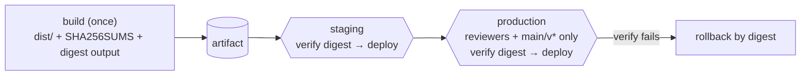
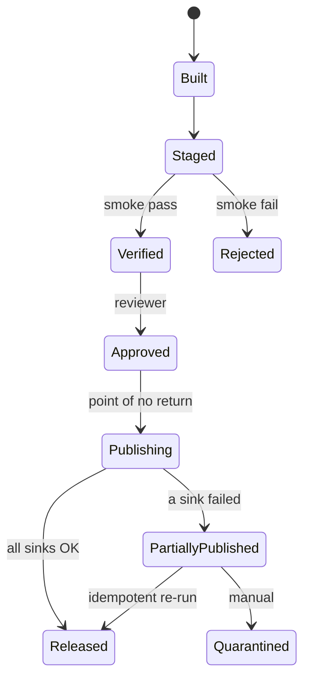

# Day 2 — Production CI for Python & R, and Release Engineering

**Assumes:** Day 1 (DAG, permissions, composition, cache identity, trust boundary)
**Activity:** [`../activities/day-02-ci-and-release-lab.md`](../activities/day-02-ci-and-release-lab.md)

**Thesis:** Fast, correct CI is mostly a caching and isolation problem. A release is an evidence-and-promotion problem. You already know the languages, so spend the effort on lockfiles, matrix size, and proving which bytes reached production.

---

## 1. The trade you are always making

**Reproducibility ↔ Speed ↔ Coverage.** Reproducibility comes from lockfiles and from pinning interpreters, images, and SHAs. Speed comes from caching and from not running things. Coverage comes from matrices, which multiply cost:

```
billed = Σ_cells (T_start + T_setup + T_test),   |M| = Π |dimension|
```

Caching reduces `T_setup`. Cutting cells reduces everything. Before you tune a cache, ask whether each cell has earned its place.

---

## 2. Python CI

**CI must install from a lockfile, with a flag that fails if the lockfile is stale.** Without that flag, CI silently re-resolves dependencies, and your green build tested a set that exists nowhere else.

```yaml
- uses: astral-sh/setup-uv@<sha> # v5
  with: { version: "0.5.29", enable-cache: true, cache-dependency-glob: "uv.lock" }
- run: uv python install ${{ matrix.python }}
- run: uv sync --frozen --all-extras --dev   # install exactly what the lock says
- run: uv lock --check                       # assert the lock still matches pyproject.toml
```

(Equivalents: `poetry check --lock` + `poetry install --sync`, or `pip install --require-hashes`.)

Cache key: `py ‖ os ‖ arch ‖ python-version ‖ H(uv.lock)`. Using `restore-keys` is safe *only* because `uv sync --frozen` reconciles the restored `.venv` afterwards.

**nox vs matrix:** use `nox` to define the tasks and the Actions matrix to run them in parallel, one session per cell (`uv run nox -s "tests-${{ matrix.python }}"`). That gives you local reproduction and parallel CI from one definition.

**Test reports are data.** Emit JUnit and coverage XML per cell, upload with `if: always()` (the failing run's report is the one you need most), and name artifacts per cell, because v4 artifacts are immutable.

---

## 3. R CI: the harder problem

The difficulty isn't the language. Binary packages are platform- and version-specific, system dependencies (GDAL, libcurl, libxml2) aren't declared anywhere, and compiling from source takes tens of minutes.

```yaml
- uses: r-lib/actions/setup-r@v2
  with: { r-version: "${{ matrix.r }}", use-public-rspm: true }   # binaries: ~20x faster
- uses: r-lib/actions/setup-r-dependencies@v2
  with: { extra-packages: "any::rcmdcheck", needs: check }        # caching + sysreqs
- uses: r-lib/actions/check-r-package@v2
  with: { error-on: '"warning"' }                                 # the production setting
```

- If you hand-roll the cache, the key is `renv ‖ os ‖ arch ‖ R major.minor ‖ H(renv.lock)`, with **no `restore-keys`**. A partially restored R library with an ABI mismatch segfaults; it doesn't reinstall cleanly.
- `error_on = "warning"` is an org-wide decision, so encode it in the reusable workflow rather than per repo.
- `shell: Rscript {0}` lets a step body be R.
- The conventional five-row cross-platform R matrix is correct for a CRAN package and wasteful for a Linux-only internal package. Cut it to one row and record the decision in the PR.

---

## 4. Containers and services

- `container:` on a job runs every step inside the image. **Pin by digest** (`image@sha256:…`), because a tag is as mutable as `@v3`.
- `services:` are sidecars for integration tests. Two addressing rules: if the job runs on the VM, use `localhost:<mapped port>` (and `ports:` is required); if the job runs in a `container:`, use `<service-label>:<port>`.
- **Health checks are mandatory.** Without `--health-cmd "pg_isready -U ci"`, the job starts before Postgres accepts connections. Someone adds `sleep 10` and the flake becomes permanent.

---

## 5. Matrix engineering

```yaml
strategy:
  fail-fast: false
  matrix:
    python: ["3.11", "3.12", "3.13"]
    os: [ubuntu-24.04, macos-14]
    exclude: [ { python: "3.13", os: macos-14 } ]
    include:
      - { python: "3.12", os: ubuntu-24.04, coverage: true }  # adds a key to an EXISTING cell
      - { python: "3.10", os: ubuntu-24.04 }                  # adds a NEW cell
```

Evaluation order: cross product (6) → `exclude` (5) → `include` (merges into a matching cell, otherwise appends one: 6). When in doubt, write explicit `include`-only rows.

- **`fail-fast: false`** for independent signals such as a version matrix, where the whole point is learning whether 3.13 alone breaks. Use `true` only for redundant smoke cells.
- **`max-parallel`** only when cells contend for a shared resource or a fixed runner pool.
- **Dynamic matrices:** a `plan` job writes compact JSON plus a `count` output. **An empty matrix is a hard error**, so guard it with `if: needs.plan.outputs.count != '0'`. A common pattern: PRs test the oldest and newest supported versions; `main` runs the full sweep.
- Matrix cell names change with their values, which is why you only ever require the **gate** check.

---

## 6. Change detection that doesn't lie

The changed-file set differs by event: PR file list, squash commit, merge commit, or speculative merge in the queue. It also answers the wrong question, "what text changed", when you need "what behavior could have changed". A defensible detector:

1. **Compute the range from the event payload**, not `HEAD~1`, and use `fetch-depth: 0`.
2. **For PRs, use `merge-base`.** A two-dot diff against a moving base pulls in other people's commits.
3. **Define global invalidators** (`uv.lock`, `renv.lock`, `pyproject.toml`, `DESCRIPTION`, `.github/`). If any of these changed, run everything.
4. **Fail open.** If you can't establish the range (force-push, all-zero `before`, a garbage-collected object), run everything.

Day 3 extends this to dependency-graph-aware affected targets.

---

## 7. Flakes

With `n` tests each flaking with probability `p`: `P(green) = (1−p)^n`. With 800 tests at 0.1% each, that's **0.45**, a coin flip. Retries (`--reruns 3`) make the check green and hide a rising `p`. **Quarantine instead:** mark the test, run it with `continue-on-error: true` outside the blocking path, give it an owner and a deadline, and track the size of the quarantine list as a metric.

To keep tests deterministic: fix the random-order seed, set `PYTHONHASHSEED=0` and `TZ=UTC`, freeze clocks, block sockets with `--disable-socket`, and use `set.seed()` plus `local_reproducible_output()` in R.

---

## 8. The gate job

```yaml
gate:
  needs: [plan, test-python, test-r, integration]
  if: always() && !cancelled()
  runs-on: ubuntu-24.04
  permissions: { contents: read }
  steps:
    - env: { RESULTS: "${{ toJSON(needs) }}" }
      run: |
        python - <<'PY'
        import json, os, sys
        results = json.loads(os.environ["RESULTS"])
        optional = {"integration"}                 # may legitimately be skipped
        bad = {n: m["result"] for n, m in results.items()
               if m["result"] not in ("success", "skipped")
               or (m["result"] == "skipped" and n not in optional)}
        for n, r in sorted(bad.items()):
            print(f"::error::{n} -> {r}")
        sys.exit(1 if bad else 0)
        PY
```

This is the only check you put in branch protection.

---

## 9. Build once, promote many

**The bytes tested in staging must be the bytes running in production.** "The same commit" isn't enough. Between two builds, a transitive dependency can publish, a base image tag can move, or a compiler can emit different output. If each rebuild drifts with probability `q`, then `P(consistent) = (1−q)^(n−1)`. You can't get `q` to zero, but you can make `n = 1`.

| Ecosystem | Immutable unit | Identity |
|---|---|---|
| Python | `.whl` / `.tar.gz` | SHA-256 per file |
| R | Source tarball / binary | SHA-256 |
| Container | Image | **Digest**, never tag |
| Terraform | Binary plan file | SHA-256 |



**Verify the digest at every promotion boundary.** Without that check, "we promoted the artifact" is an unverified claim. Deploy jobs download artifacts; they never build.

**Environment protection** (configured in settings, not YAML): required reviewers, wait timers, and, most importantly, **deployment branch/tag policy**. Without that policy, anyone who can push a branch can `workflow_dispatch` against production. The OIDC `environment:` claim is only as strong as that restriction.

---

## 10. Versioning and the release trigger

- **SemVer is behavioral.** Dropping a Python version, tightening validation, or fixing a bug people depended on is a major change in practice. Applications usually do better with CalVer.
- **Conventional commits** make the version a deterministic function of merged PR titles. Lint the title through `env:`, never by interpolating it into the shell.
- **A tag pushed with `GITHUB_TOKEN` does not trigger other workflows** (the recursion guard). Bridge that with a GitHub App token or an explicit dispatch.
- **A tag is just a pointer to *any* commit.** Guard tag-triggered releases with an ancestry check, *and* restrict the environment's tag policy, which can't be edited by the PR attacking it:

```yaml
- env: { TAG_SHA: "${{ github.sha }}" }
  run: |
    git fetch origin main --depth=100
    git merge-base --is-ancestor "$TAG_SHA" origin/main || { echo "::error::tag not on main"; exit 1; }
```

---

## 11. Publishing without long-lived credentials

**PyPI Trusted Publishing.** The job needs only `id-token: write`. On PyPI, configure the owner, the repo, the **workflow filename**, and the **environment name**. The last two stop other workflows in your own repo from publishing. A `PYPI_TOKEN` secret is a rubric failure.

**GHCR.** `GITHUB_TOKEN` with `packages: write` is enough, so you don't need a PAT. Capture `steps.push.outputs.digest` and deploy that.

**R** has no trusted publishing. Ship to r-universe (no credentials needed) or to an internal S3-backed `drat` repo via OIDC. CRAN releases stay a human step.

**Terraform: plan/apply split.** Plan with a **read-only role**, upload the *binary* `tfplan`, then apply that exact file behind a protected environment using a write role. If state has moved, Terraform rejects the stale plan, and that's what you want. Plans can contain secrets, so keep retention short.

---

## 12. Provenance: produce it *and* verify it

| Layer | Answers |
|---|---|
| Checksum | Did the bytes change? Proves nothing about origin |
| Signature (Sigstore) | Who produced this? |
| Provenance (SLSA) | From which repo, commit, and workflow? |
| SBOM | What's inside it? |

```yaml
permissions: { contents: read, id-token: write, attestations: write }
- uses: actions/attest-build-provenance@<sha> # v1
  with: { subject-path: "dist/*" }
```

```bash
gh attestation verify "dist/$WHEEL" \
  --repo "$GITHUB_REPOSITORY" \
  --signer-workflow "$GITHUB_REPOSITORY/.github/workflows/build.yml" \
  --source-ref refs/heads/main
```

| Flag | Without it, an attacker can… |
|---|---|
| `--repo` | Present an artifact attested by any repo |
| `--signer-workflow` | Add a workflow to *your* repo via a PR and attest from it |
| `--source-ref` | Attest from an unreviewed branch |

**An attestation nobody verifies is just a log entry.** Put a `verify` job in front of every publish job. Because of `--signer-workflow`, the build workflow's filename is now load-bearing API, as stable as the gate name.

---

## 13. Promotion as a state machine



**Order sinks from most to least reversible:** Actions artifact, then draft GitHub Release, then registry push, then config-repo bump, then **PyPI (irreversible; the version is burned forever)**, then flipping the release to published.

**Every sink must be idempotent with three outcomes**: `publish` (not there yet), `skip` (already there with identical bytes, so the re-run converges), and `conflict` (same version, different bytes: someone rebuilt, so stop). Multi-sink releases (PyPI + R repo + GHCR) can't be atomic, but they can **converge**. The draft release with every artifact and `SHA256SUMS` is your transaction log. On failure, label it partial and open an issue that names exactly which sinks succeeded.

**Reproducibility: state the level you actually reach.** L1 is lockfile plus pinned toolchain. L2 adds pinned image and OS packages. L3 means bit-identical builds. `SOURCE_DATE_EPOCH=$(git log -1 --pretty=%ct)` gets many pure-Python wheels to L3. If you claim L3, a CI job must rebuild, compare, and discard the rebuild.

**Rollback** goes by digest, through a `workflow_dispatch` input that you validate (`^sha256:[0-9a-f]{64}$`), because that job holds production credentials. **Database migrations don't roll back**, so use expand/contract and gate the "contract" step separately.

**Lead time** is usually dominated by human approval, not by build minutes. Auto-promote to staging and keep humans for production only.

---

## 14. Release-system rubric

| # | Check | Automatic fail |
|---|---|---|
| 1 | Built once; promotions consume and never rebuild | Build step in a deploy job |
| 2 | Digest verified at every promotion | Promotion without a check |
| 3 | OIDC publishing | A long-lived registry token |
| 4 | Irreversible sinks last and idempotent | Publish before the gate |
| 5 | Provenance verified with `--signer-workflow` | Attestation never verified |
| 6 | Production environment restricts branches/tags | Unrestricted environment |
| 7 | Tag trigger has an ancestry check | Release of an unreviewed commit possible |
| 8 | Partial publish detectable and convergent | Re-run double-publishes or hard-errors |
| 9 | Rollback by digest, tested | Rollback by tag |
| 10 | Reproducibility level stated honestly | Claim without a verification job |

**Before Day 3 you should be able to:** predict a matrix's cell count, guard an empty dynamic matrix, explain why rebuilding per environment is a correctness bug, wire OIDC publishing with the environment field set, write a verification command that constrains the signer workflow, and order a multi-sink release by reversibility.
