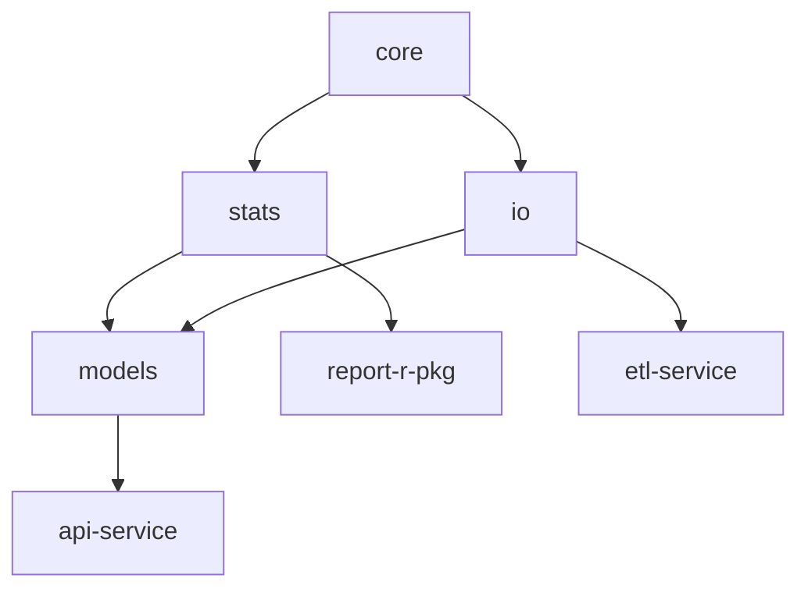

# Day 3 — Orchestration at Scale: Runners, Monorepos, Merge Queues, and Capacity

**Assumes:** Day 1 (trust boundary, gate pattern) and Day 2 (change detection, matrices, release integrity)
**Activity:** [`../activities/day-03-scale-lab.md`](../activities/day-03-scale-lab.md)

**Thesis:** The bottleneck is rarely the YAML. It's scheduler contention, runner capacity, merge integrity, and what each extra job costs.

---

## 1. What a runner is

A runner is a small agent that **long-polls GitHub over outbound HTTPS**, receives one job with a short-lived job token, runs the steps, and polls again. It needs no inbound firewall rule. **It never validates what it runs**, because authorization happened upstream.

### 1.1 Scopes, groups, labels

- Runners register at the **repo, org, or enterprise** scope. Org is the normal choice.
- **Runner groups are the access-control boundary.** A group lists which repositories (and optionally which workflows) may use its runners. A group holding production-capable runners must **deny public repos** and allow only an explicit repo list.
- **Labels are a scheduling query, not a permission.** `runs-on: [self-hosted, linux, x64, gpu]` matches a runner that advertises *all* of those labels, with no fallback and no priority. Keep a small, orthogonal vocabulary covering OS, arch, capability (`gpu`, `large-disk`), and network reach (`prod-network`). Never put team or repo names in labels; that's what groups are for.

---

## 2. Isolation: why persistent runners fail audits

A persistent self-hosted runner runs job after job on the same filesystem, the same user, and the same Docker daemon. Between jobs it cleans `_work` and nothing else.

| Residue | Where | Impact |
|---|---|---|
| Credential files | `~/.netrc`, `~/.aws`, `~/.docker/config.json`, `~/.Renviron` | Direct theft |
| Shell / git config | `~/.bashrc`, `~/.gitconfig` (`core.hooksPath`, `insteadOf`) | Code execution in every later job |
| Package / tool caches | `~/.cache/uv`, `renv` library, `$RUNNER_TOOL_CACHE` | Trojaned `python`, `Rscript` |
| Docker state | Images, volumes, socket | Container escape → host root |
| Leftover processes | Daemons that outlive the job | Persistent listener |

**`docker.sock` is host root.** `docker run -v /:/host --privileged alpine chroot /host` is documented behavior, not a bug. Use rootless Docker, a per-job daemon, or no socket at all.

**The fix is ephemeral runners.** `--ephemeral` makes a runner accept exactly one job. **Ephemeral without destroying the machine is not ephemeral**, so the supervisor must delete the VM or pod. Register with a **JIT config** (`POST /orgs/{org}/actions/runners/generate-jitconfig`). It's single-use and implies ephemeral, so the box never holds a token that could register a rogue runner.

### 2.1 Actions Runner Controller (ARC)

ARC runs one ephemeral pod per job on Kubernetes. A listener pod polls the queue depth and scales pods. **Scale on queue depth, never CPU**, because a queued job uses no CPU. Container modes: `dind` uses a privileged sidecar (fast, weaker isolation); `kubernetes` mode starts a pod per step container (slower, no privileged container).

**Cold-start tax:** `T_start = T_schedule (node scale-out: 60–180 s) + T_pull + T_register + T_toolchain`. Mitigate with a warm pool (`minRunners`), prebaked images, pre-pulled layers, and over-provisioned node groups.

**Custom images:** pin the base by digest and prebake uv, Python, R, and the system libraries. That saves 60–120 s per job but makes images stale, so rebuild on a schedule *and* whenever the base image updates, scan them, and version the image like any other artifact.

### 2.2 Network traps

- **Node IAM role:** on EC2/K8s, `curl 169.254.169.254` hands *every job* the node's credentials. That bypasses all of your environment gating. Use IMDSv2 with a hop limit of 1, block metadata from pods, and use per-pod workload identity (IRSA, or Workload Identity on GKE).
- **Hosted-runner IP allow-lists authenticate nothing.** Every Actions customer shares those CIDRs. Use OIDC, or a self-hosted runner inside the network.

### 2.3 Hardening essentials, and choosing a substrate

Three controls turn a finding into a non-finding: **ephemeral and destroyed after each job**, **never self-hosted on public repos**, and **no Docker socket**. For defense in depth, add JIT registration, explicit repo lists on runner groups, blocked IMDS, a non-root user, an egress proxy, **separate pools for untrusted and privileged work**, alerts on new runner registration, and `timeout-minutes` on every job.

| | GitHub-hosted | ARC ephemeral | Persistent self-hosted |
|---|---|---|---|
| Isolation | Per-job VM | Per-job pod | **None** |
| Cold start | 10–30 s | 20–180 s | ~0 |
| Private network | No | Yes | Yes |
| Public repos | Safe | Unsafe | Unsafe |

**Default to GitHub-hosted.** Move to ARC for a concrete requirement: private network access, special hardware, data residency, or volume where you've measured that the economics flip.

---

## 3. Monorepos: affected targets, not path filters

For a changed package set `C`, you must test the **reverse-dependency closure** `A(C) = ⋃ R(p)`. Testing everything is correct but slow. Path filters (`A ≈ C`) are cheap and **wrong**: a breaking change to `core` passes CI and breaks eleven dependents at merge time.



A change to `core` affects all seven packages; a change to `report-r-pkg` affects only itself. A graph can tell those apart and path filters can't.

```python
# .github/scripts/affected.py (core of it)
def closure(seeds, rev):
    seen, stack = set(), list(seeds)
    while stack:
        n = stack.pop()
        if n not in seen:
            seen.add(n); stack.extend(rev.get(n, ()))
    return seen

if any(f.startswith(GLOBAL_INVALIDATORS) for f in changed):   # .github/, uv.lock, renv.lock …
    affected = set(graph)                                     # fail open
else:
    seeds = {longest_prefix_owner(f) for f in changed} - {None}
    affected = closure(seeds, reverse_index(graph))
# emit {"include":[{"package":…,"path":…,"kind":"python"|"r"}]} + count + reason
```

Design rules:

1. **Build the graph from manifests:** `pyproject.toml` dependencies and the `DESCRIPTION` `Imports`/`Depends` fields. Drop external dependencies; those arrive through the lockfile, which is a global invalidator.
2. **Use longest-prefix attribution**, so `packages/core/sub/x.py` belongs to `core`.
3. **Fail open on global invalidators.**
4. **Report the reason** in the job summary.
5. **Unit-test it.** The thing that decides what CI runs is production software. Shell pipelines like `git diff | grep | cut` can't do transitive closure, and nobody tests them.

### 3.1 Orchestration shape

Use a **thin entry workflow** (triggers, concurrency, calls) → **one `plan` job** (`changed.py` + `affected.py`) → **a reusable per-package pipeline** matrixed over the affected set, with `max-parallel: 20` so a `core` change can't starve the pool → **one `gate`**. The gate must handle `count == 0` explicitly: a skipped package job plus zero affected packages is a pass, but a failed `plan` is always a fail.

---

## 4. Required checks and merge queues

### 4.1 Name stability

| Structure | Reported check name |
|---|---|
| Job `test` | `test` |
| Matrix | `test (3.12)` |
| Reusable called by `package` | `package / build` |
| Reusable + matrix | `package (core) / build` |

**A required check that never runs blocks the PR forever.** With a dynamic matrix, any required cell will eventually deadlock someone. The rule: **exactly one required check, the gate.** It always runs, it derives its verdict from `needs.*.result`, and its name is frozen.

### 4.2 Why queues exist

Two PRs can both be green against `main` and still conflict semantically: A renames `core.fit()` while B adds a caller. "Require up to date before merging" fixes this by serializing everything, which caps throughput at `1/T_CI`. A **merge queue** tests **speculative merge commits**, stacking `main + A`, then `main + A + B`, and so on, in parallel. A red slot ejects only that PR.

Throughput is about `60k / T` merges per hour for `k` slots. A per-PR failure rate `f` wastes speculation at roughly `(1−f)^(k−1)` for the deepest slot. **Queues only work if your CI is trustworthy.**

### 4.3 What you must change

```yaml
on:
  pull_request: { types: [opened, synchronize, reopened, ready_for_review] }
  merge_group:            # without this, every PR waits until timeout and is ejected
concurrency:
  group: ${{ github.workflow }}-${{ github.event.pull_request.number || github.ref }}
  cancel-in-progress: ${{ github.event_name == 'pull_request' }}   # never cancel queue runs
```

In a `merge_group` run, `github.sha` is the **speculative merge commit**, `github.ref` is `refs/heads/gh-readonly-queue/main/pr-…`, and **`github.event.pull_request` is absent**. Compute changes from `merge_group.base_sha..head_sha`, and never check out the PR head. Testing unmerged code while the queue merges something else defeats the purpose of the queue.

**Queue settings:** start with at most 5 PRs building, use squash merges, set the build timeout above your p99 CI time, and require only the gate.

**The queue is a security boundary.** Queue runs are privileged and execute PR code. That's safe only because entering the queue requires review. If anyone can enqueue without review, you've rebuilt `pull_request_target` with extra steps.

---

## 5. Capacity and queue economics

### 5.1 The objective

`min(C_infra + C_wait + C_escape)`. For a 30-engineer team, runners might cost $2–8k a month while developer waiting costs $25–60k a month. **Wait time beats infrastructure by about an order of magnitude**, which justifies over-provisioning. Teams under-provision because the idle cost shows up on a bill and the wait cost doesn't.

### 5.2 Size the pool

The offered load is `a = λ·T_s` (jobs per minute × minutes per job), and utilization is `ρ = a / c`. Wait grows roughly like `ρ / (1−ρ)`: negligible at 0.5, about 4× at 0.8, and explosive at 0.95. **Target ρ ≈ 0.6–0.7.** A pool at 100% utilization means your engineers are the buffer.

> Worked example: 40 engineers × 6 pushes × 8 jobs over an 8-hour window gives λ = 4 jobs/min. With T_s = 4 min, a = 16, so at ρ = 0.65 you need c ≈ 25. With a 3× midday peak, c_peak ≈ 74. With ARC: `minRunners: 25`, `maxRunners: 90`.

### 5.3 Find the real bottleneck

`T_feedback = T_trigger + T_queue + T_start + T_setup + T_work + T_fanin`. **Measure each term before optimizing any of them.**

| If dominant | Fix | Not the fix |
|---|---|---|
| `T_queue` | More runners, lower ρ | Caching |
| `T_start` | Warm pool, prebaked image | More runners |
| `T_setup` | Correct cache key, prebake | Bigger runners |
| `T_work` | Shard, `pytest-xdist`, cut cells | Caching |
| `T_fanin` | Flatten the DAG | More runners |

**Wall time is the critical path, not the sum of the work.** `lint → build → test → gate` (14 min) and `plan → {lint, build, test} → gate` (8 min) do the same total work. Serialize only for real data dependencies; "fail fast" sequencing trades everyone's latency for a few minutes saved.

**Sharding:** `T(k) = T_1/k + overhead`, and the knee is usually k = 4–8. Shard by historical duration, not by file count.

Pull per-job timings from `GET /repos/{repo}/actions/runs/{id}/jobs` and write a summary table that shows **queued vs ran** seconds separately.

### 5.4 Cost attribution and levers

Aggregate weighted minutes per workflow from `/actions/runs/{id}/timing`. Two surprises show up almost everywhere: **a macOS minute costs about 10× a Linux minute**, and **scheduled workflows nobody reads quietly dominate** the bill.

| Lever | Typical saving | Risk |
|---|---|---|
| Affected-target selection | 40–80% | Wrong graph means escaped breakage |
| Move macOS/Windows to nightly | 20–50% | Platform signal arrives later |
| `cancel-in-progress` on PRs | 15–30% | None, if deploys are excluded |
| Delete never-failing cells | 10–40% | Check the cell's failure history first |
| Correct cache keys | 10–25% | Stale cache if the key is too broad |

### 5.5 Tail scenarios

- **Thundering herd:** a lockfile bump fires the global invalidator and one PR becomes 200 jobs. Cap with `max-parallel`, or run the full sweep on a schedule and a representative subset on the PR.
- **Deploy starvation:** Actions has **no job priority**. **Capacity partitioning is the only priority mechanism you have**, so reserve a small `deploy` runner group.
- **Queue collapse under flakes:** at `f = 0.15` and `k = 5`, more than half of the speculative runs are wasted. If `f > 0.1`, reduce queue depth and fix the flakes first.

### 5.6 Write the budget as inequalities with enforcement

| Constraint | Target | Enforcement |
|---|---|---|
| p95 queue | < 45 s | Warm pool sized for ρ ≤ 0.7 |
| p50 feedback | < 10 min | Flat DAG, sharding, affected selection |
| Weighted minutes per PR | < 120 | Affected selection, no macOS on PRs |
| Queue ejection rate | < 2% | Flake quarantine |
| Monthly spend | < $X | Alert at 80% |

When constraints conflict, record which one you relaxed and why. "We'll monitor it" isn't a budget.

---

## 6. Control-plane rubric

| # | Check | Automatic fail |
|---|---|---|
| 1 | Affected targets from a real, unit-tested graph | Path filters as the correctness mechanism |
| 2 | Global invalidators fail open | Lockfile change can skip packages |
| 3 | One stable required gate that survives an empty matrix | Matrix cell required |
| 4 | `merge_group` in every workflow that produces a required check | Missing |
| 5 | Queue runs test the speculative commit | PR head checkout |
| 6 | Never cancel `merge_group` or `main` | Cancels queue runs |
| 7 | Ephemeral runners; privileged pool separate from untrusted | Shared persistent pool |
| 8 | `max-parallel` on wide matrices | Unbounded fan-out |
| 9 | Queue time and run time measured separately | Only total duration |
| 10 | Written budget with named enforcement | "We'll monitor it" |

**Before Day 4 you should be able to:** explain why ephemeral without destroying the machine isn't isolation, compute `A(C)`, list the `merge_group` context differences, size a pool from λ, T_s, and ρ, find the dominant term in feedback time from measurements, and explain why capacity partitioning is your only priority mechanism.
